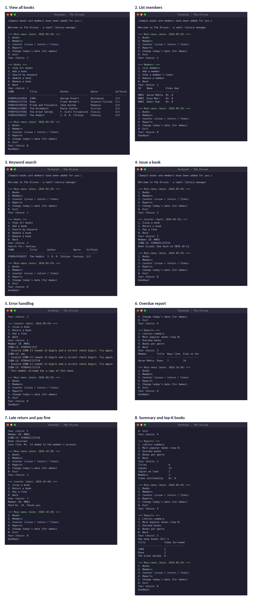

# The Alcove — a small library manager

**The Alcove** is a menu-driven library management program written in pure
Python (standard library only). It lets a librarian manage books and members,
issue and return books, charge late fines, and see simple reports.
Built as the **Build Your Own Project** for *CSE1021 – Introduction to Problem
Solving and Programming*.

## Features
| Area | What it does |
|---|---|
| **Books** | Add, view, search, update, remove; ISBN-13 check-digit validation |
| **Members** | Add, list, view loans, remove; simple IDs (`M001`, `M002`, ...) |
| **Counter** | Issue a book (14 days), return a book, fine Rs. 2 per late day, max 3 books, fines must be paid before borrowing again |
| **Reports** | Library summary, top-K most popular books, overdue books, books per genre |
| **Reliability** | Input validation, friendly error messages, data saved to a JSON file |

## Technologies used
- Python 3.8+ (standard library only: `json`, `datetime`)
- JSON file for saving data

## Project structure
```
thealcove/
├── main.py            # menus and user interaction
├── alcove/
│   ├── catalog.py     # books: add, find, update, remove, search
│   ├── members.py     # members: add, find, remove
│   ├── borrowing.py   # issue, return, fines
│   ├── insights.py    # reports
│   ├── isbn_utils.py  # ISBN-13 check-digit test
│   ├── storage.py     # load and save JSON
│   └── utils.py       # input checking, dates, LibraryError
├── data/              # alcove_data.json is created here on first run
├── screenshots.png    # all program screenshots in one image
├── README.md
└── statement.md
```

## How to run
1. Install Python 3.8 or newer (check with `python --version`).
2. Open a terminal in the project folder and run:
   ```bash
   python main.py
   ```
3. On the first run, 6 sample books and 3 sample members (`M001`, `M002`, `M003`) are created.

## Quick demo
1. **Members → List members** to see the IDs.
2. **Counter → Issue a book**: member `M001`, ISBN `9780441172719` (Dune).
3. **Change today's date** to a date three weeks ahead.
4. **Reports → Overdue books** shows the late book and the fine so far.
5. **Counter → Return a book** shows the late fine, then **Pay a fine**.
6. **Reports → Most popular books** to see the borrowing counts.

## Screenshots
All screenshots (book list, members, search, issue, error handling, overdue
report, late return and fine, and reports) are in one image:
[`screenshots.png`](screenshots.png)



## Syllabus mapping (CSE1021)
| Topic | Where it appears |
|---|---|
| Functions and modules | Every feature is a short function inside its own module |
| Fundamental algorithms | ISBN-13 digit weighting and summation (`isbn_utils.py`), counting genres |
| Lists, dictionaries, tuples | `state` dictionary, loan list, report rows as tuples |
| Sorting and searching | Keyword search (`catalog.py`), top-K books using `sorted` |
| File handling and errors | JSON load/save, `LibraryError` with try/except |

## Author
**Name:** Aditi Singh · **Register No.:** 26BCE11020 · VIT Bhopal University
